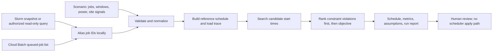

# PowerFlex: a transparent prototype for power-aware batch scheduling

**Demo and source:** [PowerFlex on GitHub](https://github.com/Hariharan2604-git/PowerFlex) · [Zenodo archive and DOI](https://doi.org/10.5281/zenodo.23852440) · [project DOI](https://doi.org/10.5281/zenodo.23852439)

PowerFlex explores a practical scheduling question: when a batch-compute job can start within a flexible window, can an operator choose a start time that better fits power, deadline, electricity-price, or carbon constraints?

It is an **independent research prototype**, not a production scheduler. The current evidence is mixed and small; it does not establish general cost, carbon, or energy savings. This project has no affiliation with, evaluation by, or endorsement from Google, Microsoft, NVIDIA, NLR, or NREL.

## Try the demo

PowerFlex is a browser-only demo. Download or clone the project, open `index.html` in a current browser, and use **Load scenario JSON** to inspect the sanitized trace scenarios. You can adjust job windows, modeled run times and power profiles, baseline load, power and ramp thresholds, and energy objectives. The interface compares a reference schedule with a candidate schedule and shows modeled constraint outcomes; it can export the inputs, assumptions, schedules, and interval results as a run report.

The previously shared GitHub Pages address currently returns a 404, so this article does not present it as a working hosted demo. The repository and DOI archive provide the code and reproducible local demo instead.

## How it is structured

The prototype has three parts: a local browser application, offline evaluation scripts, and read-only scheduler adapters.



The browser app runs locally and makes no network calls. Its deterministic heuristic considers candidate start times, then prioritizes fewer modeled hard-constraint events, less total constraint excess, and finally the selected objective score. It is not a global optimizer and may return a best-effort schedule when constraints conflict.

The Slurm adapter can read a saved `scontrol show jobs --json` snapshot or make that read-only query in an authorized cluster environment. The Google Cloud Batch adapter can list queued jobs through the Batch v1 API using local Application Default Credentials. Both create aliased recommendations plus a separate local mapping for an operator. Neither adapter changes a job. The Cloud Batch adapter has not been live-validated against a Google Cloud project, and this workspace has no authorized live Slurm connection.

## What the public-trace evaluation found

The evaluation uses public, anonymized NLR Eagle workload records and representative GPU-node iLO power measurements. A separate broad sensitivity analysis pairs selected windows with EIA-930's hourly estimated carbon intensity for the PSCO balancing authority. It reports source units, UTC alignment, cleaning, exclusions, assumptions, and privacy handling in the repository reports.

In the one-day, one-node replay, three completed single-node GPU jobs were modeled against measured whole-node power. The selected schedule reduced the largest 15-minute ramp by **12.3%** and reduced intervals above the data-derived power ceiling from **five to three**, but the modeled peak increased by **9.9%** and five ramp-limit violations remained. The thresholds are stress-test values derived from the trace, not safe operating limits.

In the broader analysis, 466 fully measured node-day windows yielded 22 one-job counterfactual cases. Four jobs shifted by at least one 15-minute slot. The regional carbon proxy improved in two cases, worsened in two, and was unchanged in eighteen; the mean change was **+0.0013%** (slightly higher), with a median of zero. This result does not show a useful general improvement.

## Reproduce the bundled results

Use Node.js 18 or newer and Python 3. From the project root, the sanitized inputs and scripts in the archive reproduce the scheduler replay and its independent report check:

```sh
node real-data/run_evaluation.mjs
python3 verify_run_report.py real-data/powerflex_real_data_run_report.json
node real-data/run_broad_evaluation.mjs
```

The first command reruns the one-day sample using the exact scheduler functions embedded in `index.html`. The Python verifier independently rebuilds the schedules and traces and recomputes metrics. The third command reruns the 22 bundled broad sensitivity cases. To inspect a case interactively, open `index.html`, select **Load scenario JSON**, and choose `real-data/scenario.json` or `real-data/broad/broad_carbon_demo_scenario.json`.

To repeat the data preparation from source, obtain the public NLR job snapshots and GPU-node meter files, plus the EIA PSCO workbook. Follow the exact input paths, commands, cleaning rules, and NLR attribution notice in [`real-data/README.md`](https://github.com/Hariharan2604-git/PowerFlex/blob/main/real-data/README.md), [`real-data/evaluation_report.md`](https://github.com/Hariharan2604-git/PowerFlex/blob/main/real-data/evaluation_report.md), and [`real-data/broad/evaluation_report.md`](https://github.com/Hariharan2604-git/PowerFlex/blob/main/real-data/broad/evaluation_report.md). The broad preparer needs Python's `openpyxl` package. Raw traces and source-node selectors are not included in the demo; only sanitized inputs and generated identifiers are shared.

## Limitations and security boundary

The public job trace has no actual user completion deadlines. The replays use explicitly synthetic slack, so they cannot establish SLA compliance. The broad analysis uses a regional average carbon estimate, not facility telemetry or marginal emissions. There is no aligned facility electricity tariff, so the real-data work does not evaluate cost. The measured power is whole-node power, not GPU-only or facility power. The one-job counterfactuals do not represent simultaneous jobs, full-cluster scheduling, or a company workload.

The demo has no authentication, roles, backend, telemetry, or external network calls. The adapters are read-only and keep operational identifiers in a separate local mapping where supported. These boundaries reduce exposure for a local prototype; they are not an enterprise security certification. A deployment would still need organizational authorization, threat modeling, SSO and role controls, tenant isolation, audit and retention policies, monitoring, secure hosting, and a supervised application path. Data provenance labels are supplied by the operator and are not independently authenticated.

## What would make the next evaluation stronger

The next useful study is a multi-day, authorized shadow evaluation against an existing scheduler, with real completion deadlines, validated runtime and power profiles, measured site power, a time-aligned electricity tariff, and an appropriately scoped carbon signal. It should compare both systems on the same workload and report deadline misses, throughput, peak and ramp behavior, reliability, cost, and carbon—with units, timezone, data-cleaning rules, and uncertainty stated up front.

Until then, PowerFlex is best read as a transparent prototype for examining scheduling trade-offs and the data required to evaluate them.

**Cite:** [PowerFlex v0.7.1](https://doi.org/10.5281/zenodo.23852440) · [Concept DOI](https://doi.org/10.5281/zenodo.23852439)
